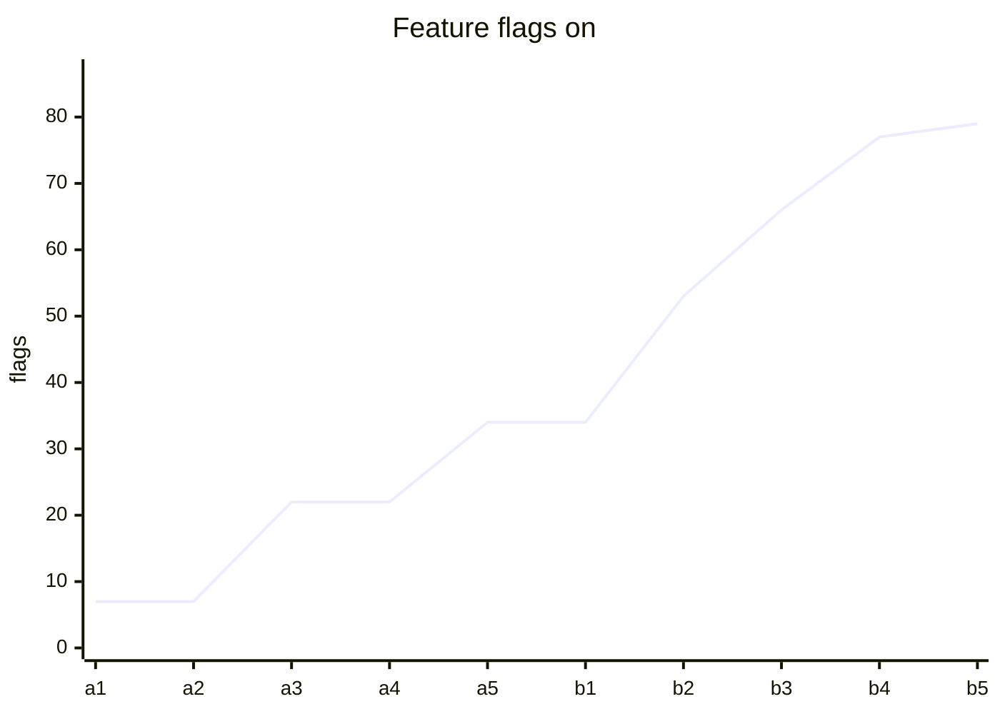
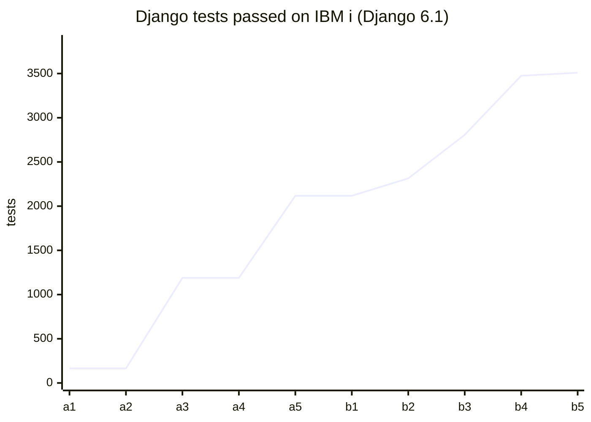

# Release history

<!-- Generated by scripts/release_history.py (bin/release-prepare); do not edit by hand. -->

How the enabled feature flags and the test results grew from release to
release.

> **Up to date with v0.1.0b5 (2026-11-16).** `bin/release-prepare`
> adds every new release to this page in the release pull request.

**Where the numbers come from**

- **Test results:** each release's own `docs/TEST_STATUS.md`, at its tag:
  the counts of the status run before that release.
- **Feature flags:**
  - from 0.1.0a4 on, the "Enabled" list of `docs/FEATURES.md` at the tag;
  - before that, the list "Feature flags set to True by the backend" in
    `TEST_STATUS.md`. For 0.1.0a4, where both lists exist, they hold the
    same flags.
- **The latest release:** [TEST_STATUS](TEST_STATUS.md) and
  [FEATURES](FEATURES.md) show its numbers in full.

## At a glance

| Release | Date | Flags on | Django versions | Django test modules | Django tests passed (6.1) | Skipped (6.1) | Expected failures (6.1) | Failed | Golden files |
|---|---|---|---|---|---|---|---|---|---|
| v0.1.0a1 | 2026-10-17 | 7 | 6.1 | 2 | 165 | 6 | 0 | 0 | 55 |
| v0.1.0a2 | 2026-10-18 | 7 | 6.1 | 2 | 165 | 6 | 0 | 0 | 55 |
| v0.1.0a3 | 2026-10-20 | 22 | 6.1 | 7 | 1189 | 53 | 7 | 0 | 150 |
| v0.1.0a4 | 2026-10-21 | 22 | 6.1, 6.0, 5.2 | 7 | 1189 | 53 | 7 | 0 | 463 |
| v0.1.0a5 | 2026-10-28 | 34 | 6.1, 6.0, 5.2 | 12 | 2117 | 189 | 53 | 0 | 520 |
| v0.1.0b1 | 2026-10-29 | 34 | 6.1, 6.0, 5.2 | 12 | 2117 | 189 | 53 | 0 | 520 |
| v0.1.0b2 | 2026-11-02 | 53 | 6.1, 6.0, 5.2 | 16 | 2314 | 205 | 63 | 0 | 559 |
| v0.1.0b3 | 2026-11-11 | 66 | 6.1, 6.0, 5.2 | 19 | 2807 | 262 | 88 | 0 | 648 |
| v0.1.0b4 | 2026-11-14 | 77 | 6.1, 6.0, 5.2 | 31 | 3475 | 281 | 71 | 0 | 669 |
| v0.1.0b5 | 2026-11-16 | 79 | 6.1, 6.0, 5.2 | 31 | 3509 | 246 | 72 | 0 | 690 |

## Feature flags per release

Which flags each release switched on, and off.

### v0.1.0a1 (2026-10-17): 7 on

Phase 1: minimal backend (its code reports version 0.0.1.dev0).

Switched on (7): `can_release_savepoints`, `has_native_boolean_field`, `implied_column_null`, `pattern_lookup_needs_param_pattern`, `requires_literal_defaults`, `supports_transactions`, `uses_savepoints`.

### v0.1.0a2 (2026-10-18): 7 on

Encoding fixes (UTF-8 statement text, long strings intact) and the signed-tag release workflow.

Switched on (0): none.

### v0.1.0a3 (2026-10-20): 22 on

Phase 2: queries & pagination (status run: 7 Django modules, 1249 tests, 0 failed).

Switched on (15): `allow_sliced_subqueries_with_in`, `nulls_order_largest`, `requires_compound_order_by_subquery`, `supports_aggregate_order_by_clause`, `supports_any_value`, `supports_boolean_expr_in_select_clause`, `supports_parentheses_in_compound`, `supports_regex_backreferencing`, `supports_select_difference`, `supports_select_intersection`, `supports_select_union`, `supports_slicing_ordering_in_compound`, `supports_subqueries_in_group_by`, `supports_temporal_subtraction`, `supports_tuple_lookups`.

### v0.1.0a4 (2026-10-21): 22 on

Phase 3: Django 6.0 and 5.2 support (status runs on 5.2, 6.0 and 6.1, 17 runs each, 0 failed; offline query corpora for all three).

Switched on (0): none.

### v0.1.0a5 (2026-10-28): 34 on

Phase 4: schema editor completeness (status runs on 5.2, 6.0 and 6.1, 22 runs each, 0 failed); released by hand, its changes are in the 0.1.0b1 section of the CHANGELOG.

Switched on (12): `can_introspect_check_constraints`, `can_introspect_default`, `can_introspect_foreign_keys`, `can_rename_index`, `can_rollback_ddl`, `ignores_table_name_case`, `indexes_foreign_keys`, `supports_column_check_constraints`, `supports_foreign_keys`, `supports_index_column_ordering`, `supports_inspectdb`, `supports_table_check_constraints`.

### v0.1.0b1 (2026-10-29): 34 on

First beta: the pre-beta review (#190, #191) done; status runs on 5.2, 6.0 and 6.1, 22 runs each, 0 failed.

Switched on (0): none.

### v0.1.0b2 (2026-11-02): 53 on

Phase 5: returning columns, bulk_create, conflicts through MERGE, partial and expression indexes, unique variants (status runs on 5.2, 6.0 and 6.1, 26 runs each, 0 failed).

Switched on (19): `allows_auto_pk_0`, `can_return_columns_from_insert`, `can_return_rows_from_bulk_insert`, `can_use_chunked_reads`, `delete_can_self_reference_subquery`, `has_bulk_insert`, `supports_default_keyword_in_bulk_insert`, `supports_default_keyword_in_insert`, `supports_expression_indexes`, `supports_functions_in_partial_indexes`, `supports_ignore_conflicts`, `supports_nullable_unique_constraints`, `supports_partial_indexes`, `supports_partially_nullable_unique_constraints`, `supports_sequence_reset`, `supports_update_conflicts`, `supports_update_conflicts_with_target`, `truncates_names`, `update_can_self_select`.

### v0.1.0b3 (2026-11-11): 66 on

Phase 6: db functions, window functions, JSONField, DB-level on_delete (status runs on 5.2, 6.0 and 6.1, 29 runs each, 0 failed).

Switched on (13): `allows_group_by_lob`, `has_json_object_function`, `has_real_datatype`, `ignores_unnecessary_order_by_in_subqueries`, `supports_aggregate_distinct_multiple_argument`, `supports_cast_with_precision`, `supports_default_in_lead_lag`, `supports_frame_range_fixed_distance`, `supports_json_field`, `supports_on_delete_db_cascade`, `supports_on_delete_db_default`, `supports_on_delete_db_null`, `supports_over_clause`.

### v0.1.0b4 (2026-11-14): 77 on

Phase 7: system names, tables in another library, select_for_update, Python 3.15, the flags Db2 for i supports, column rename by copying (opt-in) (status runs on 5.2, 6.0 and 6.1, 41 runs each, 0 failed).

Switched on (11): `can_create_inline_fk`, `has_select_for_update`, `has_select_for_update_of`, `has_select_for_update_skip_locked`, `select_for_update_of_column`, `supports_combined_alters`, `supports_date_lookup_using_string`, `supports_paramstyle_pyformat`, `supports_select_for_update_with_limit`, `supports_uuid4_function`, `test_db_allows_multiple_connections`.

### v0.1.0b5 (2026-11-16): 79 on

Comments (`db_comment`, `db_table_comment`, printable ASCII only) and JSON scalars at the top level of a `JSONField` (status runs on 5.2, 6.0 and 6.1, 41 runs each, 0 failed).

Switched on (2): `supports_comments`, `supports_primitives_in_json_field`.

## Django suite on IBM i per release

Django's own test modules on IBM i, summed over the modules supported at that
release.

| Release | Django | Modules | Tests | Passed | Failed | Skipped | Expected failures |
|---|---|---|---|---|---|---|---|
| v0.1.0a1 | 6.1 | 2 | 171 | 165 | 0 | 6 | 0 |
| v0.1.0a2 | 6.1 | 2 | 171 | 165 | 0 | 6 | 0 |
| v0.1.0a3 | 6.1 | 7 | 1249 | 1189 | 0 | 53 | 7 |
| v0.1.0a4 | 6.1 | 7 | 1249 | 1189 | 0 | 53 | 7 |
| v0.1.0a4 | 6.0 | 7 | 1159 | 1110 | 0 | 41 | 8 |
| v0.1.0a4 | 5.2 | 7 | 1144 | 1098 | 0 | 38 | 8 |
| v0.1.0a5 | 6.1 | 12 | 2359 | 2117 | 0 | 189 | 53 |
| v0.1.0a5 | 6.0 | 12 | 2244 | 2021 | 0 | 169 | 54 |
| v0.1.0a5 | 5.2 | 12 | 2200 | 1982 | 0 | 163 | 55 |
| v0.1.0b1 | 6.1 | 12 | 2359 | 2117 | 0 | 189 | 53 |
| v0.1.0b1 | 6.0 | 12 | 2244 | 2021 | 0 | 169 | 54 |
| v0.1.0b1 | 5.2 | 12 | 2200 | 1982 | 0 | 163 | 55 |
| v0.1.0b2 | 6.1 | 16 | 2582 | 2314 | 0 | 205 | 63 |
| v0.1.0b2 | 6.0 | 16 | 2465 | 2218 | 0 | 183 | 64 |
| v0.1.0b2 | 5.2 | 16 | 2416 | 2175 | 0 | 176 | 65 |
| v0.1.0b3 | 6.1 | 19 | 3157 | 2807 | 0 | 262 | 88 |
| v0.1.0b3 | 6.0 | 19 | 3005 | 2698 | 0 | 218 | 89 |
| v0.1.0b3 | 5.2 | 19 | 2951 | 2652 | 0 | 210 | 89 |
| v0.1.0b4 | 6.1 | 31 | 3827 | 3475 | 0 | 281 | 71 |
| v0.1.0b4 | 6.0 | 31 | 3655 | 3344 | 0 | 239 | 72 |
| v0.1.0b4 | 5.2 | 31 | 3568 | 3265 | 0 | 231 | 72 |
| v0.1.0b5 | 6.1 | 31 | 3827 | 3509 | 0 | 246 | 72 |
| v0.1.0b5 | 6.0 | 31 | 3655 | 3355 | 0 | 227 | 73 |
| v0.1.0b5 | 5.2 | 31 | 3568 | 3276 | 0 | 219 | 73 |

## Test sets per release

Passed / skipped / expected failures / failed of each test set, from the first
release whose TEST_STATUS has this table (0.1.0a4). The sets were renamed in
0.1.0b1 (#191); the old names are mapped to the new ones.

| Release | Django | Offline tests | IBM i tests | Django suite on IBM i | Replay tests |
|---|---|---|---|---|---|
| v0.1.0a4 | 6.1 | 2232 / 2 / 0 / 0 | 245 / 0 / 2 / 0 | 1189 / 53 / 7 / 0 | 2533 / 0 / 0 / 0 |
| v0.1.0a4 | 6.0 | 2234 / 0 / 0 / 0 | 245 / 0 / 2 / 0 | 1110 / 41 / 8 / 0 | 2473 / 0 / 0 / 0 |
| v0.1.0a4 | 5.2 | 2232 / 0 / 0 / 0 | 240 / 3 / 2 / 0 | 1098 / 38 / 8 / 0 | 2429 / 0 / 0 / 0 |
| v0.1.0a5 | 6.1 | 2941 / 2 / 0 / 0 | 328 / 0 / 1 / 0 | 2117 / 189 / 53 / 0 | 2544 / 0 / 0 / 0 |
| v0.1.0a5 | 6.0 | 2942 / 1 / 0 / 0 | 328 / 0 / 1 / 0 | 2021 / 169 / 54 / 0 | 2484 / 0 / 0 / 0 |
| v0.1.0a5 | 5.2 | 2940 / 1 / 0 / 0 | 323 / 3 / 1 / 0 | 1982 / 163 / 55 / 0 | 2440 / 0 / 0 / 0 |
| v0.1.0b1 | 6.1 | 2958 / 2 / 0 / 0 | 328 / 0 / 1 / 0 | 2117 / 189 / 53 / 0 | 2544 / 0 / 0 / 0 |
| v0.1.0b1 | 6.0 | 2959 / 1 / 0 / 0 | 328 / 0 / 1 / 0 | 2021 / 169 / 54 / 0 | 2484 / 0 / 0 / 0 |
| v0.1.0b1 | 5.2 | 2957 / 1 / 0 / 0 | 323 / 3 / 1 / 0 | 1982 / 163 / 55 / 0 | 2440 / 0 / 0 / 0 |
| v0.1.0b2 | 6.1 | 3119 / 2 / 0 / 0 | 374 / 0 / 1 / 0 | 2314 / 205 / 63 / 0 | 2585 / 0 / 0 / 0 |
| v0.1.0b2 | 6.0 | 3120 / 1 / 0 / 0 | 374 / 0 / 1 / 0 | 2218 / 183 / 64 / 0 | 2525 / 0 / 0 / 0 |
| v0.1.0b2 | 5.2 | 3118 / 1 / 0 / 0 | 369 / 3 / 1 / 0 | 2175 / 176 / 65 / 0 | 2477 / 0 / 0 / 0 |
| v0.1.0b3 | 6.1 | 3440 / 2 / 0 / 0 | 415 / 2 / 1 / 0 | 2807 / 262 / 88 / 0 | 3598 / 0 / 0 / 0 |
| v0.1.0b3 | 6.0 | 3441 / 1 / 0 / 0 | 414 / 3 / 1 / 0 | 2698 / 218 / 89 / 0 | 3518 / 0 / 0 / 0 |
| v0.1.0b3 | 5.2 | 3438 / 1 / 0 / 0 | 409 / 5 / 1 / 0 | 2652 / 210 / 89 / 0 | 3465 / 0 / 0 / 0 |
| v0.1.0b4 | 6.1 | 3654 / 2 / 0 / 0 | 452 / 2 / 1 / 0 | 3475 / 281 / 71 / 0 | 6193 / 1 / 0 / 0 |
| v0.1.0b4 | 6.0 | 3653 / 3 / 0 / 0 | 450 / 4 / 1 / 0 | 3344 / 239 / 72 / 0 | 6073 / 1 / 0 / 0 |
| v0.1.0b4 | 5.2 | 3650 / 3 / 0 / 0 | 443 / 8 / 1 / 0 | 3265 / 231 / 72 / 0 | 5881 / 1 / 0 / 0 |
| v0.1.0b5 | 6.1 | 3747 / 2 / 0 / 0 | 462 / 2 / 1 / 0 | 3509 / 246 / 72 / 0 | 6245 / 1 / 0 / 0 |
| v0.1.0b5 | 6.0 | 3743 / 3 / 0 / 0 | 457 / 4 / 1 / 0 | 3355 / 227 / 73 / 0 | 6096 / 1 / 0 / 0 |
| v0.1.0b5 | 5.2 | 3740 / 3 / 0 / 0 | 450 / 8 / 1 / 0 | 3276 / 219 / 73 / 0 | 5904 / 1 / 0 / 0 |
